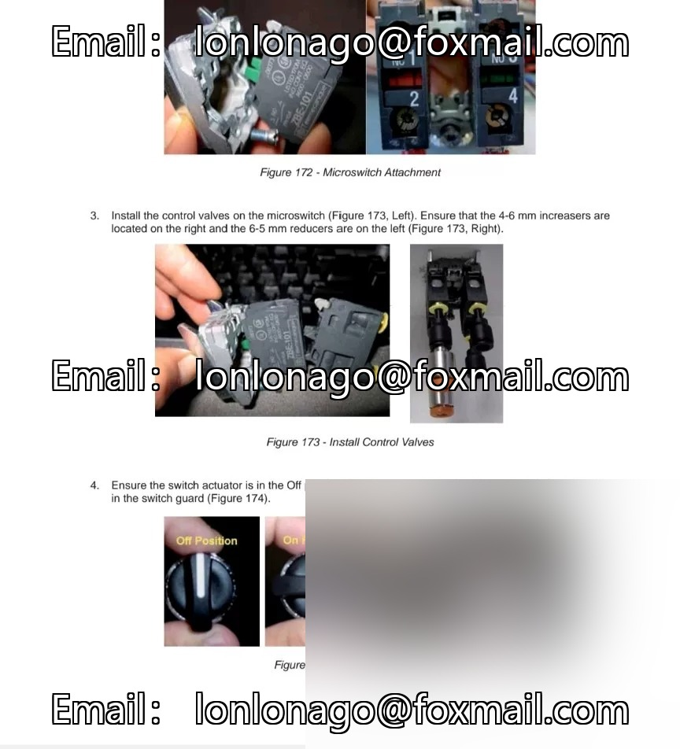
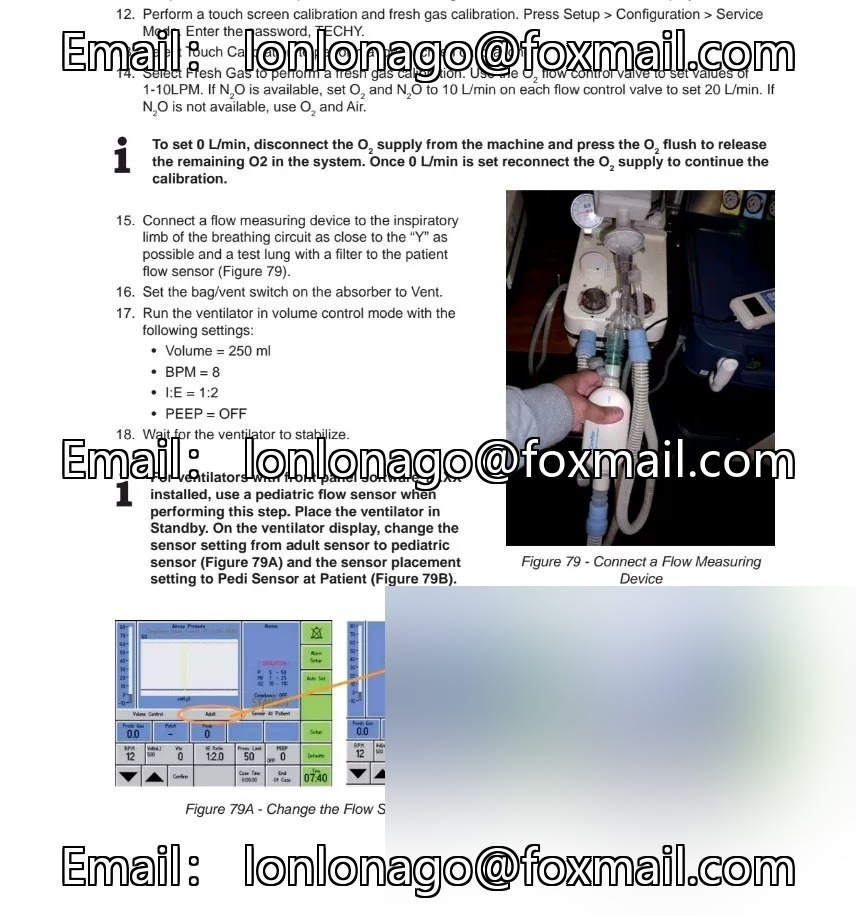
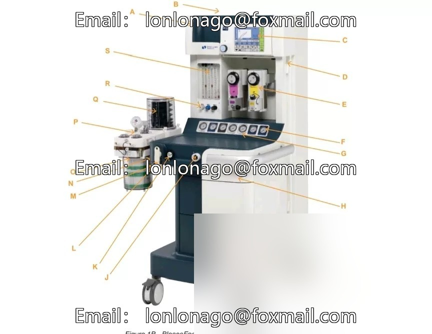

# SpaceLabs Healthcare BleaseFoc

## Body

SpaceLabs Healthcare BleaseFocus Anesthesia System Technical Manual
PDF , with 190 pages of detailed content covering system structure, installation, operation, calibration, etc., suitable for maintenance, maintenance, and technical reference.
upon sale.
809176137-070-

The manual covers anesthesia system structure, installation, operation and calibration details, including microswitch attachment, control valve installation, switch actuator placement, touch screen calibration and fresh gas calibration.

<!-- AI_ENRICHED -->

## Images

## Payment

Here is a pay link on Stripe ( https://buy.stripe.com/3cs8yP7sY87d0vu9AB ). Please contact me lonlonago@foxmail.com after funding $89, and I will send you a complete data files , thank you!

